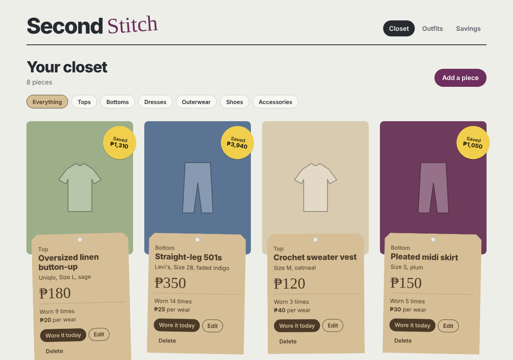
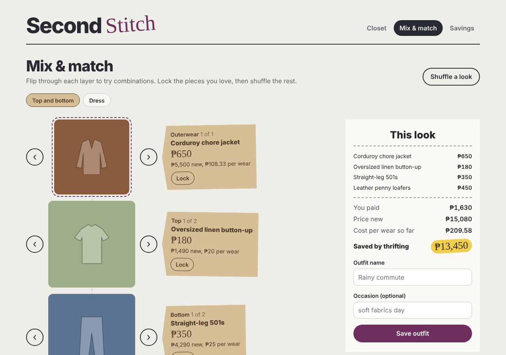
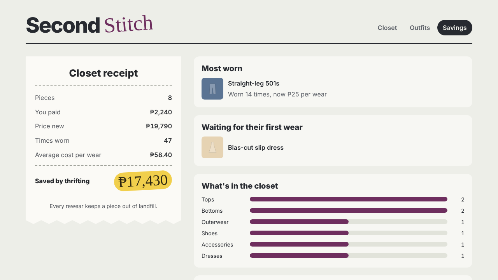

# Second Stitch


A wardrobe tracker for thrifted clothes. Log each piece you find, build outfits from what you own, and see how much you've saved and what each piece costs per wear.



## Why I built it

I thrift most of my clothes, and I wanted an answer to two questions: *is this actually cheaper than buying new once I count how often I wear it?* and *what do I already own that I'm forgetting about?* "Cost per wear" turns a ₱350 pair of jeans worn 14 times into ₱25 a wear, which makes rewearing feel rewarding.

I also designed it to be calm to use. The "Fill the gaps for me" button finishes an outfit for you on days when deciding feels like too much, the colours are low-glare, it respects reduced-motion settings, and everything works with a keyboard and screen reader.

## Features

- **Closet:** add pieces with a photo, price paid, price new, where you found it, size and colour. Filter by category.
- **Wear tracking:** a − / + counter on each piece and outfit updates cost per wear instantly, and a mis-click is one tap to undo.
- **Mix & match:** every piece sits on a rack grouped by category. Click a piece to add it to your look and click again to take it off. Picking a new top swaps out the old one, a dress replaces the top and bottom, and accessories stack. A live receipt shows each piece and what the whole look cost, its price new, cost per wear and how much thrifting saved. "Fill the gaps for me" completes a look without changing what you picked. Save looks as outfits, and "Mix again" loads one back in. Wearing an outfit logs a wear for every piece in it.
- **Savings receipt:** total paid vs. price new, average cost per wear, most-worn piece, pieces still waiting for their first wear, and your best thrift spots.





## Tech

| Layer | Tools |
| --- | --- |
| Frontend | React 19, Vite, plain CSS (light and dark mode) |
| Backend | Java 21, Spring Boot 3, Spring Data JPA, Bean Validation |
| Database | H2 locally, PostgreSQL profile for deployment |
| Testing | JUnit 5, MockMvc integration tests, Vitest, React Testing Library |
| CI | GitHub Actions runs both test suites and the build on every push |

### Architecture

```
React (Vite, :5173)
  └── api.js ──fetch /api/...──►  Spring Boot (:8080)
                                    ├── Controller   HTTP + validation
                                    ├── Service      business rules, transactions
                                    ├── Repository   Spring Data JPA
                                    └── H2 / PostgreSQL
                                  PhotoStorage → ./uploads
```

### API

| Method | Path | What it does |
| --- | --- | --- |
| GET | `/api/items?category=TOP` | List pieces, optionally by category |
| POST | `/api/items` | Add a piece |
| PUT | `/api/items/{id}` | Edit a piece |
| DELETE | `/api/items/{id}` | Delete a piece (also removes it from outfits) |
| POST | `/api/items/{id}/wear` | Add a wear |
| DELETE | `/api/items/{id}/wear` | Remove a wear (never below 0) |
| POST | `/api/items/{id}/photo` | Upload a photo (JPG, PNG or WebP, up to 5 MB) |
| GET | `/api/items/{id}/photo` | Get the photo |
| GET | `/api/outfits` | List outfits |
| POST | `/api/outfits` | Save an outfit `{ name, occasion, itemIds }`; returns `totalPaid`, `totalRetail` and `totalSaved` |
| POST | `/api/outfits/{id}/wear` | Add a wear to the outfit and every piece in it |
| DELETE | `/api/outfits/{id}/wear` | Remove a wear from the outfit and every piece in it |
| DELETE | `/api/outfits/{id}` | Delete an outfit |
| GET | `/api/stats` | Savings and closet breakdown |

Errors always come back as `{ "message": "...", "fields": { "name": "Give the piece a name" } }`.

## Run it locally

You need Java 21, Maven (or IntelliJ IDEA, which includes it) and Node.js 20.19 or newer.

```bash
# Terminal 1: backend on http://localhost:8080
cd backend
mvn spring-boot:run

# Terminal 2: frontend on http://localhost:5173
cd frontend
npm install
npm run dev
```

The first run fills the closet with sample pieces. Delete `backend/data/` to start fresh.

## Tests

```bash
cd backend && mvn test     # unit + API integration tests
cd frontend && npm test    # component and helper tests
```

## What I'd add next

- Auto-detect a piece's colour and category from its photo
- Sensory notes per piece (texture, tags, seams) to filter for comfortable days
- Deploy with PostgreSQL and cloud photo storage
